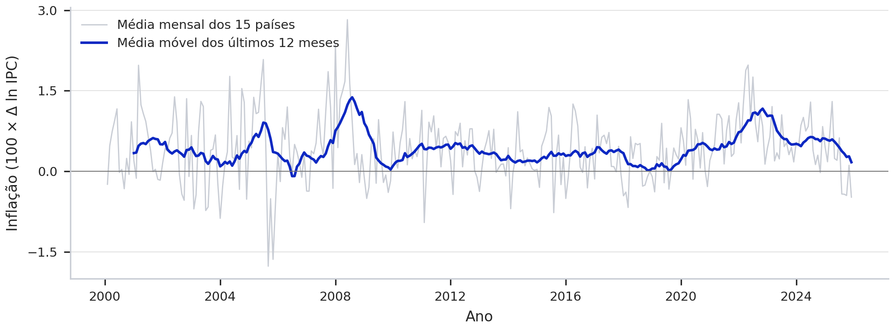
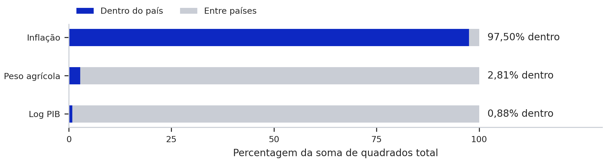
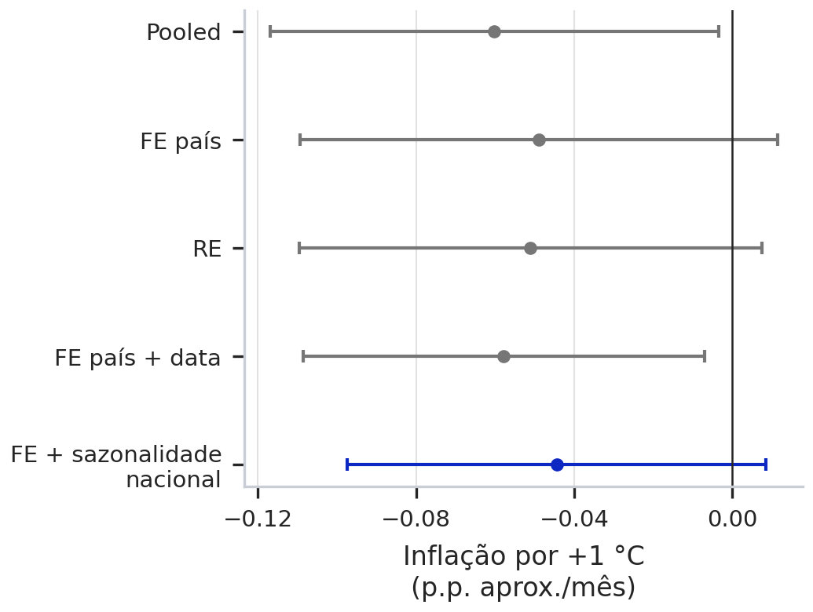
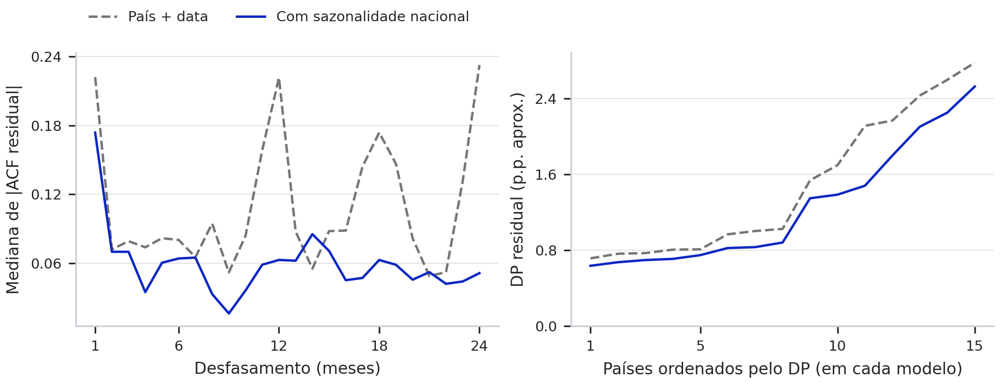
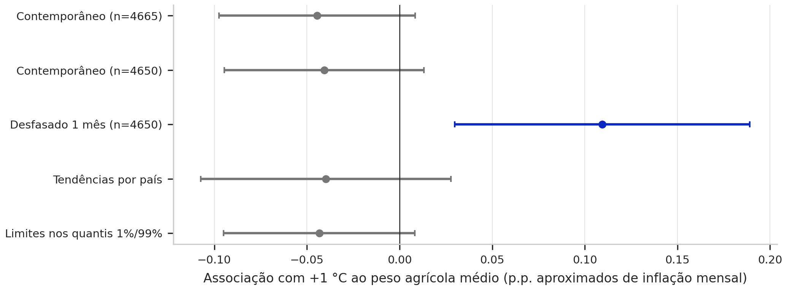

# Parte 1 — Clima e inflação alimentar

A inflação alimentar varia sobretudo ao longo do tempo dentro de cada país. A associação estimada com a temperatura depende do calendário usado na regressão: no modelo contemporâneo com efeitos de país, data e sazonalidade nacional, +1 °C associa-se a -0,044 [-0,097; 0,008] pontos percentuais aproximados de inflação mensal, ao peso agrícola médio. O intervalo de 95% inclui zero. Com a temperatura do mês anterior, a estimativa é positiva, 0,109 [0,030; 0,189], numa amostra comparável. Os resultados descrevem associações condicionais e não identificam um efeito causal do aquecimento global.

Esta síntese cobre as secções 3.1–3.3 do guião. Os quatro notebooks incluem os cálculos, as tabelas completas e os diagnósticos. A Parte 2 e o relatório final conjunto são trabalhos distintos desta entrega técnica.

## 1. Problema e dados

**Q1.** Como evoluiu a inflação alimentar mensal entre 2000 e 2025 e em que diferem os países?

**Q2.** Como se associa a inflação alimentar às anomalias térmicas e ao défice hídrico, depois de controlar diferenças persistentes entre países e choques comuns? Essa associação varia com o peso da agricultura?

O painel reúne Benim, Burkina Faso, Burundi, Mali, Níger, Nigéria, Senegal, África do Sul, Brasil, Honduras, México, Tailândia, Japão, Espanha e Portugal. São 15 países, 311 meses e 4 665 observações, de fevereiro de 2000 a dezembro de 2025. A seleção combina disponibilidade de séries completas com diversidade climática e de estruturas produtivas. É uma amostra intencional, não uma amostra representativa do mundo: oito países são africanos. Não é possível atribuir o mecanismo histórico exato da seleção sem documentação do grupo.

Cada linha corresponde a um par país–mês. O painel é equilibrado e regular, não tem duplicados nem omissos nas variáveis utilizadas. Os extremos são mantidos na análise principal. A união das regras IQR global e nacional sinaliza 600 observações (12,9%); a classificação como extremo não basta para concluir que existe erro.

A resposta é 100 × Δln(IPC alimentar), calculada a partir do índice mensal FAOSTAT, sem ajuste sazonal. Mede pontos logarítmicos, aproximadamente percentagem mensal; a aproximação à taxa percentual simples é menos precisa nos maiores extremos. Janeiro de 2000 fornece o primeiro IPC de referência e não pertence à amostra de regressão.

Usam-se três variáveis de base e uma interação: anomalia térmica em °C; défice hídrico de três meses em desvios padrão; peso agrícola do ano anterior, em pontos percentuais do PIB; e anomalia × peso agrícola. O indicador do Banco Mundial abrange agricultura, silvicultura e pesca. O valor anual é repetido nos meses do ano seguinte, sem interpolação: há 390 pares país–ano de informação económica, não 4 665 medições económicas independentes. O log PIB permanece na exploração como comparação de contexto, mas não é um quinto regressor da especificação principal.

O peso agrícola é centrado na média de 15,436% do PIB. A centragem preserva os valores ajustados e permite interpretar o coeficiente da temperatura num nível observado da variável moderadora. Mantém-se o efeito próprio da agricultura para respeitar a hierarquia da interação; o seu coeficiente não é interpretado como um efeito estrutural ou causal.

### Fontes e reprodução

A [FAOSTAT](https://www.fao.org/faostat/en/#data/CP) reúne os índices alimentares usados para medir preços; os códigos, as flags, as datas de extração e os ficheiros estão no manifesto. As fontes anuais são os [World Development Indicators](https://data.worldbank.org/indicator/NV.AGR.TOTL.ZS). O clima provém do [CRU-CY v4.10](https://crudata.uea.ac.uk/cru/data/hrg/), uma base científica institucional da UEA/NCAS com séries mensais agregadas por país, adequada à frequência e à unidade de análise. CRU não é um instituto nacional de estatística; essa distinção deve ser mantida ao justificar a fonte perante a UC.

A anomalia é a temperatura observada menos a média de 1991–2020 do mesmo país e mês. O balanço hídrico é precipitação menos PET diária multiplicada pelos dias do mês. Soma-se esse balanço em três meses e calcula-se (média histórica − balanço observado) / desvio padrão histórico, por país e mês, com ddof=1. Valores positivos representam condições mais secas. Este índice não é SPEI.

Foram recuperados os arquivos originais e o script de construção num pacote local cujo painel coincide com a entrada do projeto. Os 51 hashes do manifesto foram confirmados; a reconstrução offline reproduz o painel e as duas tabelas brutas com tolerância numérica de 10⁻¹⁰. O histórico climático inclui 1901–2025, permitindo recalcular as normais de 1991–2020 e as janelas que atravessam o início da amostra. As versões recolhidas em outubro de 2026 sustentam uma análise retrospetiva, não uma previsão com versões disponíveis em tempo real.

## 2. O que a exploração mostra

A inflação mensal média é 0,411, a mediana 0,336 e o desvio padrão 1,782. Cerca de 33,9% das observações são negativas. A média nacional vai de 0,126 no Japão a 1,203 na Nigéria; o desvio padrão vai de 0,51 em Espanha a 2,99 no Burundi. As diferenças de volatilidade são, portanto, substanciais.

A média mensal aumenta de 0,297 em 2010–2019 para 0,582 em 2020–2025. Esta subida ocorre em 14 dos 15 países. A média transversal atribui igual peso a cada país; não representa a inflação mundial ponderada pela população ou pela despesa.

**Figura 1.** Média transversal mensal e média móvel retrospetiva de 12 meses. Fonte: cálculos sobre o IPC FAOSTAT incluído no projeto. A linha suavizada ajuda a ler a evolução, sem substituir a resposta mensal dos modelos.

A decomposição exata da soma de quadrados atribui 97,50% da variabilidade da inflação a mudanças dentro dos países. Na agricultura, 97,19% é entre países; no log PIB, 99,12%. O FE dispõe, por isso, de pouca variação temporal para estimar o efeito próprio das variáveis económicas. A interação continua a variar mensalmente, mas isso não garante precisão nem identificação causal.

**Figura 2.** Parcelas aditivas da soma de quadrados total. Fonte: painel do projeto; cada observação tem igual peso. O azul mostra a variação dentro dos países. As três variáveis não partilham a mesma unidade; comparam-se percentagens da respetiva variabilidade.

A sazonalidade difere entre países: a amplitude do perfil médio é 0,64 em Espanha e 5,48 no Níger. O mês de maior inflação é janeiro em Portugal e junho no Níger. Os efeitos de data podem captar movimentos comuns, mas não substituem controlos para estes calendários nacionais. As correlações contemporâneas brutas com a inflação são pequenas: −0,028 para a temperatura e −0,021 para o défice hídrico.

## 3. Especificação e estimação

O modelo geral é y_it = β₀ + β₁ T_it + β₂ D_it + β₃ Aᶜ_i,t−1 + β₄ T_it Aᶜ_i,t−1 + α_i + λ_t + γ_i,m(t) + ε_it. T é a anomalia térmica; D o défice hídrico; Aᶜ o peso agrícola centrado. Os efeitos γ representam o padrão sazonal específico do país. Não se incluem todos os efeitos em todos os modelos.

| Modelo | Heterogeneidade do país αᵢ | Tempo λₜ | Sazonalidade nacional |
|---|---|---|---|
| Pooled | Ausente | Ausente | Ausente |
| FE país | Interceptos fixos | Ausente | Ausente |
| RE | Intercepto aleatório | Ausente | Ausente |
| FE país + data | Interceptos fixos | Efeito para cada data | Ausente |
| FE país + data + sazonalidade | Interceptos fixos | Efeito para cada data | Contrastes país × mês |

O trio inicial compara a forma de tratar αᵢ mantendo os quatro termos, a amostra e a ausência de efeitos de tempo. As extensões FE acrescentam os controlos de calendário na mesma amostra. A comparação entre o RE de base e o FE final altera também os controlos temporais; não é interpretada como uma diferença exclusiva entre estimadores.

O pooled combina informação dentro e entre países e pressupõe que a heterogeneidade omitida não cria correlação com as explicativas. O FE admite correlação entre αᵢ e as covariáveis e estima associações a partir de mudanças dentro de cada país. Com efeitos de data, retira também os movimentos comuns. O RE exige E(αᵢ | Xᵢ) = 0 e combina informação dentro e entre países por GLS. Esta hipótese é forte: características persistentes como instituições, estrutura alimentar e integração comercial podem relacionar-se com clima e agricultura. Mesmo o FE requer exogeneidade adequada dos erros idiossincráticos; controlar αᵢ não resolve todas as fontes de endogeneidade.

Todos os modelos usam erros padrão agrupados por país, com correção finita. Os intervalos apresentados usam a distribuição t com 14 graus de liberdade. São aproximações com apenas 15 grupos; os 4 665 registos não tornam irrelevante esse limite. No RE, a transformação de quasi-demeaning usa θ = 0,664; a variância estimada do intercepto aleatório é 0,078.

## 4. Comparação dos modelos

**Tabela 1.** Coeficientes e IC 95% agrupados por país. Mesmas 4 665 observações e quatro termos explicativos. As unidades da resposta são pontos logarítmicos mensais, aproximadamente pontos percentuais.

| Termo | Pooled | FE pais | RE |
|---|---|---|---|
| Anomalia térmica | -0,060 [-0,117; -0,003] | -0,049 [-0,109; 0,011] | -0,051 [-0,110; 0,007] |
| Défice hídrico | -0,028 [-0,107; 0,050] | -0,025 [-0,104; 0,055] | -0,026 [-0,105; 0,052] |
| Peso agrícola centrado | 0,005 [-0,007; 0,017] | -0,032 [-0,073; 0,009] | -0,002 [-0,014; 0,010] |
| Anomalia × peso agrícola | -0,001 [-0,004; 0,001] | -0,001 [-0,003; 0,002] | -0,001 [-0,003; 0,001] |
| Observações | 4665 | 4665 | 4665 |
| R² do modelo | 0,0021 | 0,0272 | 0,0008 |

O R² do pooled/FE acima é o R² total da regressão OLS, incluindo interceptos nacionais no FE. O R² do RE é calculado no modelo transformado por GLS e não tem a mesma base. Os resíduos RE devolvidos pela biblioteca também se referem à transformação GLS; o seu RMSE não é diretamente comparável ao RMSE residual OLS na escala original. Nenhuma escolha é feita pela comparação direta destes números.

O coeficiente da temperatura passa de -0,060 [-0,117; -0,003] no pooled para -0,049 [-0,109; 0,011] no FE de país. O sinal negativo mantém-se, mas o intervalo do FE inclui zero. O efeito próprio da agricultura também muda de sinal; isso mostra que uma associação entre países não deve ser confundida com uma associação dentro do mesmo país.

**Tabela 2.** Extensões FE na mesma amostra; intervalos calculados da mesma forma.

| Termo | FE pais e data | FE pais data sazonal |
|---|---|---|
| Anomalia térmica | -0,058 [-0,109; -0,007] | -0,044 [-0,097; 0,008] |
| Défice hídrico | -0,022 [-0,092; 0,049] | -0,022 [-0,081; 0,037] |
| Peso agrícola centrado | -0,031 [-0,065; 0,003] | -0,031 [-0,066; 0,004] |
| Anomalia × peso agrícola | 0,002 [-0,002; 0,007] | 0,002 [-0,004; 0,008] |
| Observações | 4665 | 4665 |
| R² do modelo | 0,1464 | 0,3805 |

**Figura 3.** Associação com +1 °C ao peso agrícola médio, com IC 95% agrupados por país. Fonte: Tabelas 1–2. A linha vertical marca zero; o azul identifica a especificação contemporânea preferida.

### Como ler as magnitudes

No FE final, +1 °C associa-se a -0,044 p.p. aproximados de inflação mensal ao peso agrícola médio. Um aumento de uma unidade no défice (um desvio padrão da referência climática do país e mês) associa-se a -0,022 p.p.; o respetivo intervalo inclui zero. Mais 1 p.p. de peso agrícola, quando a anomalia térmica é zero, corresponde a -0,031 p.p. de inflação. Esta última estimativa usa pouca variação anual dentro do país e pode refletir tendências ou fatores omitidos.

O coeficiente da interação é 0,0017 p.p. de inflação por °C e por p.p. de peso agrícola. O IC inclui zero; não há evidência suficiente, nesta especificação contemporânea, de que o declive térmico difira com a agricultura. O efeito marginal é β₁ + β₄ Aᶜ, e o seu intervalo deve usar a covariância entre os dois coeficientes.

A tabela de efeitos marginais do notebook mostra intervalos pontuais abaixo de zero nos quantis 25% e 50% da agricultura e um intervalo que inclui zero no quantil 75%. Esses intervalos não foram ajustados para comparações múltiplas e não demonstram, por si só, uma diferença entre quantis. Evita-se assim concluir tanto «não há qualquer associação» como «a agricultura modifica comprovadamente a associação».

### Escolha do modelo e Hausman

Privilegia-se o FE com país, data e sazonalidade nacional para descrever a associação contemporânea: permite correlação entre os fatores persistentes do país e X, controla choques comuns e respeita a heterogeneidade sazonal observada antes da estimação. O maior R² não é o fundamento da escolha. O modelo ainda deixa dependência e heterogeneidade nos resíduos.

O Hausman compara apenas FE país e RE de base, com a mesma amostra e quatro regressores. A subtração direta das covariâncias, cada uma com a sua estimativa de variância do erro, gera autovalores negativos. Foi aplicada a variante com variância comum do RE, segundo o princípio de `sigmamore` descrito no [manual do Stata](https://www.stata.com/manuals/rhausman.pdf). Os coeficientes não são alterados; não se regulariza a matriz nem se força uma inversa generalizada. A matriz normalizada é definida positiva e o teste produz χ²(4) = 10,466, p = 0,0333. Sob as hipóteses clássicas, há evidência contra as restrições do RE de base.

A normalização resolve a dificuldade numérica, mas não torna o Hausman robusto. A heteroscedasticidade e a autocorrelação residuais limitam a sua interpretação. Como diagnóstico complementar, aplicou-se a [abordagem de Mundlak](https://blog.stata.com/2015/10/29/fixed-effects-or-random-effects-the-mundlak-approach/): acrescentar ao RE as médias nacionais dos quatro regressores, incluindo a média da interação, e testar se os quatro coeficientes são conjuntamente zero. Com covariância agrupada por país, a referência F aproximada dá F(4,14) = 5,730, p = 0,0060. A igualdade entre os declives do modelo aumentado e os do FE foi verificada numericamente.

O teste complementar aponta contra a hipótese de ausência de correlação entre heterogeneidade nacional e regressores, dentro da aproximação linear de Mundlak. Com apenas 15 grupos e dependência transversal possível, a evidência continua aproximada. Ambos os testes referem-se ao trio de base, sem efeitos de data; não escolhem por si só entre os calendários dos modelos finais. A preferência pelo FE mantém-se fundamentada nas hipóteses, no problema e nos resíduos.

## 5. Resíduos e limites da inferência

No FE com data, os desvios padrão residuais variam entre 0,713 e 2,780. Ao incluir sazonalidade nacional, variam entre 0,635 e 2,528, uma razão de 3,98. A dispersão continua a diferir bastante entre países, sustentando a utilização de erros padrão robustos.

O Ljung–Box a 12 meses sinaliza 14 países no FE com data e 9 no FE final; a 24 meses, sinaliza 13 no FE final. São diagnósticos exploratórios dos resíduos estimados, com valores-p individuais não ajustados por multiplicidade, e não testes exatos após absorver muitos efeitos. As ACF são sempre calculadas dentro do país. A redução da dependência sazonal não permite declarar os resíduos independentes.

**Figura 4.** Esquerda: mediana do valor absoluto das ACF calculadas país a país. Direita: desvios padrão nacionais ordenados separadamente em cada modelo. Fonte: resíduos estimados. O eixo horizontal da direita indica posições na ordenação, não correspondências fixas entre países.

A mediana das correlações residuais entre países é -0,095 no FE final; a mediana dos valores absolutos é 0,212. A presença de efeitos de data força restrições às somas transversais dos resíduos e pode induzir correlações negativas. Não se interpreta uma mediana próxima de zero como prova de independência. O agrupamento por país acomoda dependência dentro do país, mas não toda a dependência entre países. Por isso, intervalos e valores-p devem ser tratados como evidência aproximada, sobretudo quando próximos de 5%.

Uma auditoria adicional confrontou a inferência agrupada com [Driscoll–Kraay](https://www.statsmodels.org/stable/generated/statsmodels.stats.sandwich_covariance.cov_nw_groupsum.html), que admite dependência temporal e transversal numa aproximação de dimensão temporal longa. Usou-se kernel de Bartlett, larguras fixadas de 12 e 24 meses e correção N/(N−K). Com 12 meses, o erro padrão da temperatura contemporânea é 0,047, com IC [-0,137; 0,048] e p aproximado 0,3439. Para o lag de um mês, o IC é [0,019; 0,200], p aproximado 0,0183. A referência t(T−1) é aproximada. Os dois calendários e as duas larguras são apresentados, sem escolher a que dá menor valor-p. É uma sensibilidade adicional, não uma garantia de validade nem uma alteração dos coeficientes.

Ao retirar um país de cada vez, o coeficiente contemporâneo da temperatura varia de -0,056 a -0,016. Mantém o sinal negativo, mas a magnitude é sensível à composição da amostra. O centro da agricultura é mantido fixo na amostra original para que se compare o mesmo efeito marginal. Os 15 resultados de cada calendário ficam guardados, sem selecionar exclusões para a análise principal.

## 6. Tendências e análises de sensibilidade

Para a inflação mensal, o ADF com constante rejeita a hipótese de raiz unitária nos 15 países; o KPSS rejeita estacionariedade em torno de uma constante em 2. Os resultados são compatíveis com uma taxa menos persistente do que o nível do IPC, mas não excluem quebras e mudanças de média. Usar 100 × Δln(IPC) é coerente com o problema dos preços mensais e evita regredir diretamente índices de preços tendenciais.

As covariáveis económicas foram testadas na frequência anual, com apenas 26 observações por país e constante/tendência. Para a agricultura, o ADF rejeita raiz unitária em 5 países e o KPSS rejeita estacionariedade em torno de uma tendência em 8. Para o log PIB, os números são 3 e 9. Os valores-p do KPSS nos limites tabulados são assinalados no CSV. A baixa potência e os resultados mistos não autorizam concluir estacionariedade em todos os países. O log PIB não entra no modelo principal; o peso agrícola é tratado sobretudo como moderador e o seu efeito próprio recebe uma interpretação prudente.

São reportadas três verificações adicionais, sem escolher a conclusão pelo menor valor-p: tendências lineares específicas por país, limites de 1%/99% na resposta e substituição da temperatura corrente pela temperatura desfasada um mês. As duas primeiras mantêm 4 665 observações. O desfasamento perde um mês por país; por isso, também se reestima o contemporâneo nos mesmos 4 650 pares país–mês. Em ambos se mantém o défice corrente, a agricultura anual e quatro termos substantivos. A interação desfasada usa a temperatura anterior e o peso agrícola aplicável ao mês da resposta.

**Figura 5.** Coeficiente térmico e IC 95% ao peso agrícola médio. Fonte: regressões de sensibilidade. Os limites nos quantis alteram somente uma cópia da resposta; não constituem limpeza dos dados originais.

O coeficiente contemporâneo mantém-se negativo com tendências nacionais e com os limites nos quantis; ambos os intervalos incluem zero. A versão desfasada dá 0,109 [0,030; 0,189] p.p. por +1 °C. A interação desfasada é positiva (0,007 [0,002; 0,013]). Esta sensibilidade é substantiva: o momento da exposição muda a interpretação. Substituir a temperatura corrente pelo lag não estima simultaneamente os dois efeitos nem um efeito acumulado; persistência climática e termos dinâmicos omitidos podem afetar o resultado. A especificação desfasada não é promovida a principal por ser significativa.

[Kotz et al. (2024)](https://doi.org/10.1038/s43247-023-01173-x) estudam a relação entre temperaturas e inflação com dinâmica mais extensa. O seu trabalho motiva examinar o calendário dos efeitos, mas não valida os coeficientes deste painel: diferem a amostra, as variáveis e a especificação. Não se interpreta uma correlação contemporânea pequena como demonstração de ausência de efeitos climáticos.

## 7. Respostas às questões e limitações

**Q1:** a inflação alimentar é heterogénea entre países e períodos, mas quase toda a sua variabilidade ocorre dentro dos países. A média aumenta no período mais recente e existem calendários sazonais nacionais distintos.

**Q2:** o sinal contemporâneo da temperatura é negativo nos modelos estimados, mas a evidência ao peso agrícola médio deixa de excluir zero quando se controla a sazonalidade nacional. O défice hídrico e a interação contemporânea também têm intervalos que incluem zero. A variante desfasada apresenta associações positivas com temperatura e interação, mostrando que a conclusão depende da definição temporal da exposição.

O FE com data e sazonalidade é a especificação contemporânea preferida pelas suas hipóteses e pelos padrões observados. Os resultados não devem ser usados para afirmar que o calor reduz causalmente os preços ou que a agricultura protege ou agrava causalmente a inflação. Comércio, câmbios, energia, conflitos, políticas agrícolas e choques de oferta não estão explicitamente modelados. Acrescem erros de medição, médias climáticas nacionais que não coincidem necessariamente com áreas agrícolas, diferenças de cabazes do IPC, apenas 15 países, seleção não aleatória e dependência residual. A variável anual tem resolução limitada e o seu desfasamento não garante disponibilidade em tempo real.

O próximo passo científico seria avaliar dinâmica climática adicional e inferência sensível à dependência transversal, com hipóteses e comparações definidas antecipadamente. Isso é uma extensão; não altera retroativamente a especificação apresentada.

## Reprodução e verificação

Na raiz do projeto, executar `python scripts/verificar_reproducao.py` e `python scripts/reexecutar.py` no ambiente com `requirements.txt`. O primeiro comando verifica as fontes e reconstrói os indicadores; o segundo executa os quatro notebooks pela ordem de leitura. A estimação também confirma o posto completo das matrizes, a equivalência do FE com a transformação within e a invariância dos valores ajustados à centragem da agricultura.

O registo no Excel da UC e a identificação dos membros não foram verificados. A declaração de IA está documentada separadamente, limitada ao apoio conhecido nesta revisão; cabe ao grupo completar usos anteriores e assumir a versão que entregar. O relatório final de quatro páginas deve integrar também a Parte 2, que não está incluída nesta síntese.
