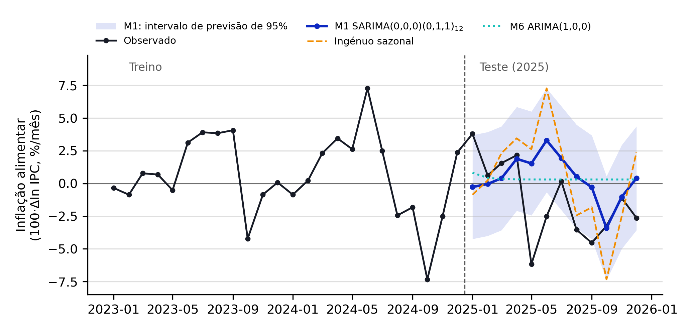

# Parte 2 — Inflação alimentar no Níger: SARIMA e previsão de 2025

A inflação alimentar mensal do Níger tem uma sazonalidade anual forte: sobe de março a junho e desce de julho a outubro. O modelo escolhido só com os dados até dezembro de 2024 é o SARIMA(0,0,0)(0,1,1)₁₂, com um único coeficiente, Θ₁ = −0,782. Na validação com origem móvel de 2015–2024, erra menos do que o ARIMA sem componente sazonal e do que as referências simples (RMSE 2,036, contra 2,233 a 2,588). Em 2025, supera a referência ingénua sazonal (RMSE 3,632 contra 4,609), mas não o ARIMA sem componente sazonal (3,229) nem a média do treino (3,273). O IPC alimentar caiu 14,3% ao longo de 2025 e, em maio e junho, a inflação foi a mais baixa desses meses em 26 anos, ao contrário do padrão sazonal.

Esta síntese cobre a secção 4 do guião. Os cálculos estão no notebook 05 (secção 4.1) e no notebook 06 (secções 4.2 e 4.3); as tabelas completas estão em `resultados/tabelas/06_sarima/`.

## 1. Problema, série e divisão temporal

**Problema (guião, secção 4).** Como evolui a inflação alimentar no Níger e até que ponto é possível prever os seus valores futuros a partir do seu passado?

A resposta é a mesma da Parte 1: 100 × Δln(IPC alimentar), em pontos logarítmicos, aproximadamente percentagem por mês. A série do Níger tem 311 meses, de fevereiro de 2000 a dezembro de 2025, com frequência mensal regular, sem duplicados nem omissos. O treino vai de fevereiro de 2000 a dezembro de 2024 (299 meses) e o teste cobre os 12 meses de 2025. Todas as escolhas de modelo usam só o treino.

O Níger foi escolhido pela sazonalidade. No treino, tem a maior amplitude sazonal dos 15 países (5,67 pontos entre a maior e a menor média mensal, contra 1,14 em Portugal) e a segunda maior autocorrelação no lag 12 (0,413, depois do Senegal, com 0,502). É também, a seguir ao Burundi, o país com maior peso médio da agricultura no PIB (37,4%, contra 38,0%) e menor log do PIB por habitante (7,24, contra 6,92).

## 2. Identificação

A série não tem tendência: oscila em torno de uma média de 0,304 no treino. O padrão sazonal tem o máximo em junho (média de 4,03 em 2000–2024) e o mínimo em outubro (−1,64). Esse padrão não é fixo: o máximo cai sempre em junho, mas a amplitude passa de 7,70 em 2000–2008 para 6,08 em 2009–2016 e 4,99 em 2017–2024. Uma sazonalidade que muda é compatível com sazonalidade estocástica.

No treino, o ADF rejeita a raiz unitária (valor-p 0,003) e o KPSS não rejeita a estacionaridade (valor-p ≥ 0,10): não é precisa diferença simples (d = 0). A ACF decai muito devagar nos lags sazonais (0,41, 0,39 e 0,38 nos lags 12, 24 e 36), sinal de não estacionaridade sazonal que estes testes não avaliam. Depois da diferença sazonal, as autocorrelações nos lags 24 e 36 ficam perto de zero, o ADF rejeita a raiz unitária (valor-p < 0,001) e o KPSS continua sem rejeitar: D = 1, com s = 12. Na série com diff(12), a ACF tem um pico isolado no lag 12 (−0,47) e a PACF decai nos lags sazonais, o padrão de um MA sazonal de ordem 1; nos primeiros lags, as autocorrelações são próximas de zero (0,023 no lag 1).

## 3. Estimação e comparação

Os seis candidatos testam alterações concretas ao modelo identificado. M2 a M4 acrescentam um termo de curto prazo ou um AR sazonal; M5 retira a diferença sazonal; M6 é o ARIMA sem componente sazonal pedido no guião, com AR(1) pelo pico no lag 1 da ACF e da PACF. Os modelos com D = 1 não têm constante (a média da série com diff(12) é 0,008); os modelos com D = 0 têm.

**Tabela 1.** Candidatos estimados no treino. Ljung–Box nos resíduos, com graus de liberdade = lag − (p + q + P + Q). Os AIC e BIC de M5 e M6 (D = 0) assentam em 299 observações e não se comparam com os de M1 a M4 (D = 1, 287 observações).

| Modelo | Especificação | Coeficiente acrescentado (valor-p) | AIC | BIC | Ljung–Box, valor-p (lags 12; 24; 36) |
|---|---|---|---|---|---|
| M1 | SARIMA(0,0,0)(0,1,1)₁₂ | — | 1234,96 | 1242,28 | 0,773; 0,684; 0,225 |
| M2 | SARIMA(1,0,0)(0,1,1)₁₂ | φ₁ = 0,046 (0,385) | 1236,34 | 1247,32 | 0,769; 0,733; 0,243 |
| M3 | SARIMA(0,0,1)(0,1,1)₁₂ | θ₁ = 0,046 (0,402) | 1236,35 | 1247,33 | 0,770; 0,731; 0,241 |
| M4 | SARIMA(0,0,0)(1,1,1)₁₂ | Φ₁ = 0,010 (0,907) | 1236,95 | 1247,93 | 0,692; 0,630; 0,194 |
| M5 | SARIMA(0,0,0)(1,0,1)₁₂ + constante | Φ₁ = 0,961, IC 95% [0,919; 1,003] | 1283,20 | 1298,00 | 0,480; 0,634; 0,227 |
| M6 | ARIMA(1,0,0) + constante | φ₁ = 0,248 (< 0,001) | 1372,62 | 1383,72 | < 0,001 nos três |

Entre os modelos com a mesma diferenciação, o M1 tem o menor AIC e o menor BIC, e nenhum dos coeficientes acrescentados é significativo a 5%. O M6 deixa autocorrelação nos resíduos em todos os lags sazonais: a sazonalidade anual é sustentada pelos dados. No M5, o AR sazonal estimado fica muito perto de 1 e o intervalo inclui 1; com Φ₁ = 1, o M5 passaria a ter a diferença sazonal do M1, o que reforça D = 1. Entre M5 e M6, que partilham a mesma base, os termos sazonais fazem descer o AIC de 1372,6 para 1283,2. Numa grelha de ARIMA não sazonais (p, q ≤ 2), o menor AIC é o do ARIMA(2,0,2), mas este imita a sazonalidade com raízes AR complexas de módulo 1,002 e período de 12,1 meses, e todos os nove modelos da grelha deixam autocorrelação nos resíduos; o M6 mantém-se como comparação.

### Validação com origem móvel

Como o AIC não compara diferenciações diferentes nem mede previsões, repetiu-se dentro do treino o exercício do teste: em dezembro de cada ano de 2014 a 2023, cada modelo foi reestimado com os dados até essa data e previu os 12 meses seguintes. São 10 janelas e 120 previsões por método, todas de 2015–2024. As referências são o ingénuo sazonal (o valor do mesmo mês do ano anterior) e a média do histórico disponível.

**Tabela 2.** Erros de previsão a 1–12 meses, em pontos percentuais por mês (erro = observado − previsto). Validação: 120 previsões feitas a partir do treino; teste: 12 previsões de 2025 feitas em dezembro de 2024.

| Método | MAE validação | RMSE validação | MAE teste | RMSE teste |
|---|---|---|---|---|
| M1 SARIMA(0,0,0)(0,1,1)₁₂ (final) | 1,541 | 2,036 | 2,751 | 3,632 |
| M5 SARIMA(0,0,0)(1,0,1)₁₂ + constante | 1,494 | 2,013 | 2,709 | 3,533 |
| M6 ARIMA(1,0,0) + constante | 1,694 | 2,233 | 2,686 | 3,229 |
| Média do treino | 1,704 | 2,247 | 2,742 | 3,273 |
| Ingénuo sazonal | 1,859 | 2,588 | 3,526 | 4,609 |

Na validação, os dois modelos sazonais erram menos do que o ARIMA, a média e o ingénuo sazonal; o MAE ordena os métodos da mesma forma. O RMSE do M1 é 21,3% menor do que o do ingénuo sazonal, que repete o ano anterior com os seus extremos. M1 e M5 são quase o mesmo modelo: o M5 erra um pouco menos (o RMSE do M1 é 1,1% maior e o MAE 3,2% maior) e tem RMSE menor em 6 das 10 janelas.

**Modelo final: M1.** Tem o menor AIC e BIC entre os modelos com a mesma diferenciação, resíduos sem autocorrelação e, na validação, erros abaixo do ARIMA e das referências e só um pouco acima do M5. É também o mais simples (um coeficiente, contra três no M5), e a diferença sazonal é coerente com a identificação. A escolha foi fixada antes de usar os dados de 2025.

## 4. Modelo final e resíduos

O modelo é $y_t = y_{t-12} + \varepsilon_t + \Theta_1\,\varepsilon_{t-12}$, com Θ₁ = −0,782 (erro padrão 0,047; IC 95% [−0,875; −0,690]) e σ² = 4,10. Como |Θ₁| < 1, o MA sazonal é invertível. Para cada mês, a previsão é 0,218 × o valor desse mês no ano anterior + 0,782 × a previsão que o modelo fazia para esse mês: o modelo pondera vários anos, em vez de copiar o último.

O Ljung–Box não rejeita a ausência de autocorrelação nos resíduos (valores-p 0,773, 0,684 e 0,225 nos lags 12, 24 e 36, com 11, 23 e 35 graus de liberdade), e a média dos resíduos é 0,019. O Jarque–Bera rejeita a normalidade (assimetria 0,64; curtose 4,85): há mais meses extremos do que a normal prevê, o que pode tornar os intervalos de 95% demasiado estreitos. O teste H do statsmodels não rejeita variância igual entre o primeiro e o último terço da amostra (valor-p 0,359), mas o desvio padrão anual dos resíduos vai de 1,19 em 2014 a 3,40 em 2005: há anos mais voláteis do que outros.

## 5. Previsão de 2025

**Figura 1.** Inflação alimentar mensal do Níger, 2023–2025: valores observados, previsões para 2025 feitas em dezembro de 2024 e intervalo de previsão de 95% do M1. Fonte: cálculos sobre o IPC FAOSTAT incluído no projeto.

As previsões estão na escala da resposta: a série não foi transformada para a modelação e o SARIMAX devolve as previsões já na escala da inflação, sem transformação inversa. Em 2025, o M1 erra menos do que o ingénuo sazonal (RMSE 21,2% menor e MAE 22,0% menor), mas o seu RMSE é 12,4% maior do que o do ARIMA sem componente sazonal e 11,0% maior do que o da média; no MAE, fica praticamente igual à média (2,751 contra 2,742). O M5 fica perto do M1 (RMSE 3,533), por isso a escolha entre D = 0 e D = 1 não muda a conclusão.

Todos os métodos sobrestimaram 2025: o erro médio do M1 é −1,698. Só 7 dos 12 meses caem dentro do intervalo de 95% do M1, que tem a mesma largura nos 12 meses (±3,97), porque, até 12 meses, só o choque do próprio mês é desconhecido. Os maiores erros do M1 estão em maio (−7,71), junho (−5,81), setembro (−4,25), janeiro (+4,06) e agosto (−4,05). Em maio e junho, quando o padrão sazonal é de subida, observou-se −6,17 e −2,51, os valores mais baixos destes meses em 26 anos e abaixo do mínimo do treino. Ao longo de 2025, o IPC alimentar caiu 14,3%; o M1 previa uma subida de 5,0%.

O M1 pondera os junhos anteriores, e junho de 2024 teve o segundo valor mais alto do treino (+7,27): o modelo previu nova subida em 2025. A média e o ARIMA preveem cerca de 0,3 em quase todos os meses e, por não preverem a subida de maio a julho, erraram menos. A única informação anterior a dezembro de 2024 que o painel oferece sobre este ano é climática: entre agosto e outubro de 2024, o défice hídrico de 3 meses no Níger foi o mais húmido dos 25 anos do treino. O painel não tem dados de produção e, no modelo preferido da Parte 1, o défice hídrico do mesmo mês tem um coeficiente com IC 95% que inclui zero; a ligação fica como hipótese a testar, não como explicação dos erros.

O RMSE do M1 é 2,062 no treino (a um passo), 2,036 na validação e 3,632 no teste. Treino e validação estão ao mesmo nível, sem sinal de sobreajustamento; o salto no teste vem de 2025 ter fugido ao padrão.

## 6. Respostas às questões e limitações

**Existe sazonalidade anual?** Sim: a ACF do treino tem 0,41 no lag 12, o máximo cai sempre em junho e, sem termos sazonais, os resíduos ficam autocorrelacionados (Ljung–Box com valor-p < 0,001).

**A componente sazonal melhora as previsões?** Na validação de 2015–2024, sim: RMSE de 2,036 no M1, contra 2,233 no ARIMA sem componente sazonal. No teste de 2025, não, porque o ano saiu do padrão sazonal; ainda assim, o M1 supera a referência ingénua sazonal. Um ano atípico não chega para concluir que a sazonalidade deixou de existir.

**Qual é a precisão fora da amostra?** Em 2025, MAE de 2,751 e RMSE de 3,632 pontos percentuais por mês, cerca de 1,8 vezes o RMSE da validação.

**Limitações.** Um ano de teste são 12 observações, e o RMSE do M1 varia entre 1,23 e 2,84 de janela para janela na validação. A variância dos resíduos muda ao longo do tempo e os erros têm caudas mais pesadas do que a normal; o intervalo de 95% cobriu 7 dos 12 meses de 2025. O modelo só usa o passado da série. Ficam como trabalho futuro um SARIMAX com variáveis conhecidas na origem da previsão, como o défice hídrico desfasado, e uma variância que mude no tempo. Os 311 valores do IPC alimentar do Níger têm o sinalizador X da FAOSTAT (valor de uma organização externa).

**Ligação com a Parte 1.** Os modelos de painel estudam associações entre países e dentro de cada país; o SARIMA explora a dependência temporal de uma série. O R² do painel e o RMSE da previsão medem tarefas diferentes e não se comparam.

## Reprodução e verificação

Os notebooks 05 e 06 leem `dados/processados/painel_longo.csv` e correm sem ligação à Internet, com as versões de `requirements.txt`. Foram executados de raiz num kernel limpo a 20 e 21/11/2026. As afirmações do notebook 06 estão protegidas por verificações (`assert`) que interrompem a execução se os resultados mudarem. As tabelas, sem arredondamentos, estão em `resultados/tabelas/06_sarima/`; as figuras para o relatório estão em `resultados/graficos/06_sarima/`, em PNG a 300 ppp e PDF.
